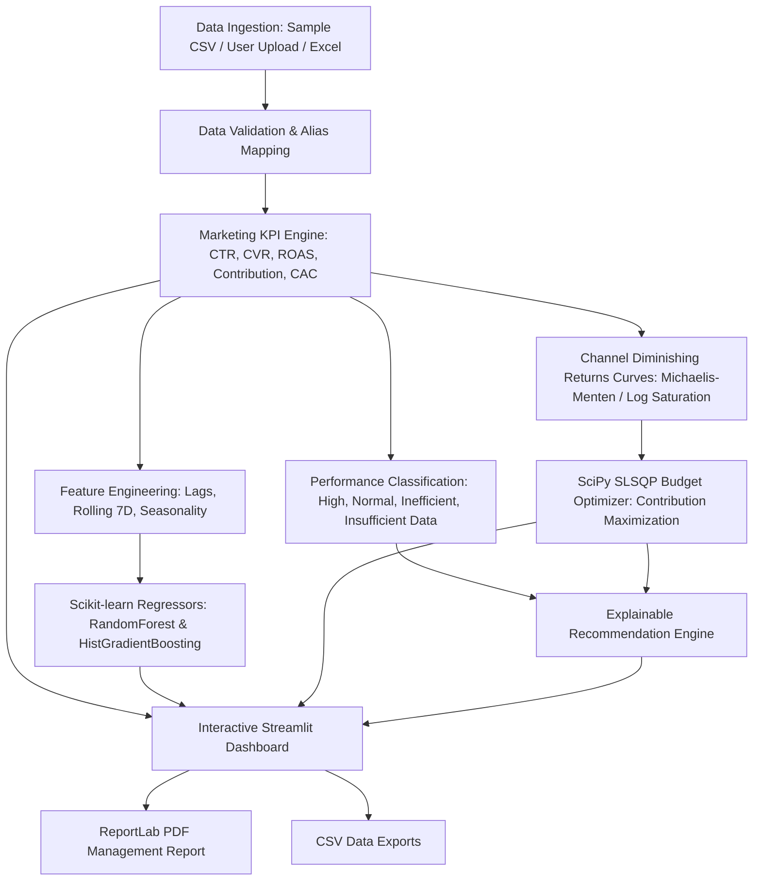

# Amazon AI Marketing Budget Optimization Agent

An enterprise-grade, AI-driven Marketing Budget Optimization Agent designed for an Amazon-inspired multi-channel e-commerce business case study. The application analyzes marketing expenditure across major digital advertising channels, identifies underperforming and inefficient campaigns, forecasts future revenue using Scikit-learn regressors, and optimizes marketing budget allocation via SciPy constrained optimization under diminishing marginal returns.

> **Academic & Professional Demonstration Notice:** This is an independent marketing decision-support demonstration project developed using realistic synthetic e-commerce data and user-provided inputs. It is **not** an official Amazon application and does not claim access to Amazon's private internal marketing systems. All budget modifications require explicit human authorization before live deployment.

---

## Table of Contents

1. [Project Overview & Business Problem](#1-project-overview--business-problem)
2. [Key Features](#2-key-features)
3. [System Architecture](#3-system-architecture)
4. [Technology Stack](#4-technology-stack)
5. [Directory Structure](#5-directory-structure)
6. [Dataset Schema & Synthetic Generation](#6-dataset-schema--synthetic-generation)
7. [Marketing KPI Mathematical Formulas](#7-marketing-kpi-mathematical-formulas)
8. [Machine Learning Pipeline](#8-machine-learning-pipeline)
9. [Budget Optimization & Diminishing Returns](#9-budget-optimization--diminishing-returns)
10. [Explainable AI Recommendations](#10-explainable-ai-recommendations)
11. [PDF Executive Management Report](#11-pdf-executive-management-report)
12. [Installation & Setup on macOS](#12-installation--setup-on-macos)
13. [Running Automated Tests](#13-running-automated-tests)
14. [How to Launch and Use the Application](#14-how-to-launch-and-use-the-application)
15. [How to Upload Custom CSV / Excel Datasets](#15-how-to-upload-custom-csv--excel-datasets)
16. [Publishing to GitHub](#16-publishing-to-github)
17. [Limitations & Modeling Assumptions](#17-limitations--modeling-assumptions)

---

## 1. Project Overview & Business Problem

Modern multi-channel e-commerce brands invest marketing capital across multiple ad networks—including Amazon Sponsored Products, Sponsored Brands, Sponsored Display, Google Ads, Meta Ads, Email, and Affiliate programs.

However, marketing leadership frequently struggles with:
- **Capital Inefficiency:** Spending heavily on high-cost-per-acquisition (CPA) campaigns that fail to generate profitable contribution.
- **Premature Decisions on Low Data:** Pausing new or exploratory campaigns before gathering statistically significant evidence.
- **Linear Budgeting Fallacy:** Assuming that doubling ad spend on a top-performing channel will double revenue, ignoring channel saturation and the economic law of diminishing marginal returns.
- **ROAS vs. ROI Confusion:** Conflating top-line revenue multipliers (ROAS) with true contribution profit after deducting cost-of-goods-sold (COGS) and advertising spend.

### The AI Agent Solution
This application coordinates a complete 10-step autonomous decision workflow:
1. **Data Ingestion & Schema Alignment:** Ingests CSV or Excel campaign records, automatically mapping alternative column headers.
2. **Quality Validation:** Rigorously verifies non-negative spend, clicks $\le$ impressions, conversions $\le$ clicks, and deduplicates records.
3. **KPI Calculation:** Safely computes 11 core financial and marketing efficiency metrics with strict zero-division protection.
4. **Campaign Classification:** Categorizes campaigns into *High Performing*, *Performing Normally*, *Underperforming*, *Potentially Inefficient*, or *Insufficient Data*.
5. **Time-Series ML Regression:** Trains chronological Scikit-learn regressors (Random Forest & Histogram Gradient Boosting) to forecast revenue and conversions without future data leakage.
6. **Saturation Curve Modeling:** Solves non-linear diminishing return parameters for each marketing channel.
7. **Constrained SciPy Optimization:** Solves for the exact contribution-maximizing budget allocation respecting bounds and experiment reserves.
8. **Explainable Recommendations:** Produces tactical, prioritized recommendations with explicit numerical proof.
9. **Interactive Streamlit Dashboard:** Provides an Amazon-styled executive command center.
10. **ReportLab PDF Generation:** Compiles an executive-ready PDF management report with running page counts ("Page X of Y").

---

## 2. Key Features

- **Amazon-Themed Executive Dashboard:** Navy (`#232F3E`), Amazon Orange (`#FF9900`), and clean Slate aesthetics with Plotly visualizations.
- **Zero-Division Safe KPI Engine:** Prevents division-by-zero crashes, rendering `N/A` cleanly for inactive campaigns.
- **Flexible Data Ingestion:** Supports built-in 90-day calibrated Amazon synthetic data, custom CSV uploads, and custom Excel (`.xlsx`) uploads with alias mapping.
- **Diminishing Returns Solver:** Employs parameterized concave logarithmic saturation curves $R(s) = \alpha \ln(1 + \beta s)$.
- **Constrained Optimization:** Implements SciPy SLSQP optimization subject to total budgets, channel bounds, and experimental testing reserves.
- **Automated Two-Pass PDF Reporting:** Dynamically creates formatted PDF documents using ReportLab with custom running headers and footers.
- **100% Tested:** 23 passing Pytest unit and integration tests covering edge cases, math constraints, and model pipelines.

---

## 3. System Architecture



---

## 4. Technology Stack

| Component | Library / Tool | Version | Purpose |
| :--- | :--- | :--- | :--- |
| **Language** | Python | 3.11 / 3.12 / 3.13 | Core programming language |
| **Data Processing** | Pandas, NumPy | $\ge 2.0.0$ | Vectorized manipulation and aggregations |
| **Machine Learning** | Scikit-learn | $\ge 1.6.0$ | Random Forest & HistGradientBoosting regressors |
| **Optimization** | SciPy | $\ge 1.15.0$ | Constrained non-linear optimization (SLSQP) |
| **Interactive UI** | Streamlit | $\ge 1.40.0$ | Modern responsive executive web application |
| **Data Visualization** | Plotly | $\ge 5.20.0$ | Interactive charts and efficiency scatter matrices |
| **PDF Reporting** | ReportLab | $\ge 4.0.0$ | Publication-grade PDF compilation |
| **File Formats** | OpenPyXL | $\ge 3.1.0$ | Excel (`.xlsx`) spreadsheet processing |
| **Testing** | Pytest | $\ge 8.0.0$ | Automated test verification |

---

## 5. Directory Structure

```text
amazon_marketing_optimizer/
├── app.py                      # Streamlit interactive application entry point
├── requirements.txt            # Pinned dependencies
├── README.md                   # Comprehensive documentation
├── .gitignore                  # Git ignore rules
│
├── data/
│   └── sample_campaign_data.csv # 2,600+ row calibrated synthetic Amazon dataset
│
├── src/
│   ├── __init__.py             # Package marker
│   ├── data_loader.py          # Data loaders and synthetic dataset generator
│   ├── data_validation.py      # Schema validation, alias mapping, and integrity checks
│   ├── feature_engineering.py  # Temporal, rolling, and historical feature creation
│   ├── metrics.py              # Mathematical KPI engine with zero-division safety
│   ├── campaign_analysis.py    # Performance classification and efficiency matrix
│   ├── prediction_model.py     # Scikit-learn ML pipelines and evaluation
│   ├── budget_optimizer.py     # SciPy SLSQP optimization and saturation response curves
│   ├── recommendation_engine.py# Deterministic, explainable recommendation generator
│   └── pdf_report.py           # ReportLab PDF executive report builder
│
├── tests/
│   ├── test_data_validation.py # Data validation, alias, and edge-case unit tests
│   ├── test_metrics.py         # KPI mathematical correctness and zero-division tests
│   ├── test_budget_optimizer.py# Budget optimizer, bound checks, and sensitivity tests
│   └── test_recommendations.py # Recommendation engine, ML training, and PDF tests
│
├── reports/                    # Directory where generated PDF reports are saved
└── assets/                     # Logos and presentation assets
```

---

## 6. Dataset Schema & Synthetic Generation

The dataset covers **7 distinct marketing channels** across **6 product categories** over a 90-day window:

| Column Name | Data Type | Description |
| :--- | :--- | :--- |
| `date` | String (YYYY-MM-DD) | Campaign reporting date |
| `campaign_id` | String | Unique identifier (e.g., `CMP-SP-001`) |
| `campaign_name` | String | Descriptive campaign name |
| `channel` | String | Channel (`Amazon Sponsored Products`, `Google Ads`, etc.) |
| `product_category` | String | Department (`Electronics`, `Home & Kitchen`, etc.) |
| `marketing_spend` | Float | Advertising expenditure in USD |
| `impressions` | Integer | Total ad impressions served |
| `clicks` | Integer | Total shopper clicks received |
| `conversions` | Integer | Total customer orders / purchases attributed |
| `attributed_revenue` | Float | Attributed customer sales revenue in USD |
| `gross_margin_rate` | Float | Category gross margin rate (e.g., `0.35` for 35%) |
| `new_customers` | Integer | Estimated first-time buyer acquisitions |
| `returning_customers` | Integer | Estimated repeat customer acquisitions |

---

## 7. Marketing KPI Mathematical Formulas

The engine implements standard financial and digital advertising formulas:

$$\text{CTR} = \frac{\text{Clicks}}{\text{Impressions}} \times 100$$

$$\text{Conversion Rate (CVR)} = \frac{\text{Conversions}}{\text{Clicks}} \times 100$$

$$\text{CPC} = \frac{\text{Marketing Spend}}{\text{Clicks}}$$

$$\text{CPA} = \frac{\text{Marketing Spend}}{\text{Conversions}}$$

$$\text{ROAS} = \frac{\text{Attributed Revenue}}{\text{Marketing Spend}}$$

$$\text{Estimated Gross Profit} = \text{Attributed Revenue} \times \text{Gross Margin Rate}$$

$$\text{Marketing Contribution} = \text{Estimated Gross Profit} - \text{Marketing Spend}$$

$$\text{Marketing ROI (\%)} = \frac{\text{Estimated Gross Profit} - \text{Marketing Spend}}{\text{Marketing Spend}} \times 100$$

$$\text{CAC} = \frac{\text{Marketing Spend}}{\text{New Customers}}$$

$$\text{Average Revenue Per Conversion (ARPC)} = \frac{\text{Attributed Revenue}}{\text{Conversions}}$$

*Safety Note:* When denominators equal zero or data is missing, the functions return `None` or `NaN`, cleanly rendering as `"N/A"` in tables and reports.

---

## 8. Machine Learning Pipeline

- **Chronological Split:** The first 80% of calendar dates form the training set; the remaining 20% form the held-out test set. This strictly eliminates future data leakage.
- **Preprocessor:** `ColumnTransformer` with `OneHotEncoder(handle_unknown='ignore')` on categorical variables (`channel`, `product_category`) and `StandardScaler()` on engineered numeric variables.
- **Features Included:**
  - `day_of_week`, `day_of_month`, `month`, `is_weekend`
  - `campaign_age_days` (days since first observed date)
  - `rolling_7d_spend`, `rolling_7d_revenue` (lagged by 1 day)
  - `historical_cpc`, `historical_ctr`, `historical_cvr` (cumulative historical metrics)
- **Model Algorithms:**
  - `RandomForestRegressor(n_estimators=120, max_depth=12, min_samples_leaf=3)`
  - `HistGradientBoostingRegressor(max_iter=150, learning_rate=0.08)`
- **Evaluation:** Evaluated on Mean Absolute Error (MAE), Root Mean Squared Error (RMSE), and $R^2$ against an empirical baseline model (historical channel efficiency).

---

## 9. Budget Optimization & Diminishing Returns

### Diminishing Returns Curve
To prevent the optimizer from naively funneling all money into the highest historical ROAS channel, each channel is calibrated to a strictly concave saturation curve:

$$R_c(s) = \alpha_c \cdot \ln(1 + \beta_c \cdot s)$$

Where:
- $R_c(0) = 0$
- First derivative (marginal ROAS): $\frac{dR_c}{ds} = \frac{\alpha_c \cdot \beta_c}{1 + \beta_c s} > 0$
- Second derivative: $\frac{d^2 R_c}{ds^2} = -\frac{\alpha_c \cdot \beta_c^2}{(1 + \beta_c s)^2} < 0$ (diminishing returns)

### Mathematical Formulation
$$\max_{s} \sum_{c=1}^{N} \left( m_c \cdot R_c(s_c) - s_c \right)$$

Subject to:
1. $\sum_{c=1}^N s_c = B_{\text{alloc}} = B_{\text{total}} \times (1 - \text{reserve\_pct})$
2. $\text{min\_spend}_c \le s_c \le \text{max\_spend}_c \quad \forall c \in \{1, \dots, N\}$
3. $\frac{\sum R_c(s_c)}{B_{\text{alloc}}} \ge \text{Target ROAS}$

Solved using **SciPy SLSQP** (`scipy.optimize.minimize`) with exact penny-balancing to guarantee that allocations sum strictly to the allocatable budget.

---

## 10. Explainable AI Recommendations

The recommendation engine translates empirical metrics and optimization shifts into prioritized business actions across 5 strategic categories:
1. **Budget Reallocation:** Identifies channels with high marginal ROAS for gradual budget expansion, and flags underperforming channels for capital reduction.
2. **Conversion Rate Optimization:** Surfaces campaigns with high traffic ($\ge 120$ clicks) but low conversion rates ($<2.5\%$), recommending Amazon Product Detail Page (PDP), image gallery, and search query audits.
3. **Bidding Strategy:** Detects campaigns with CPAs exceeding target thresholds by $>35\%$, prescribing 15–25% max CPC bid reductions and keyword match-type tightening.
4. **Experimentation:** Allocates the dedicated exploratory reserve pool ($5\%–10\%$) to test emerging channels and keywords with capped daily budgets.
5. **Campaign Efficiency:** Highlights high-ROAS campaigns currently constrained by low budgets for selective scaling.

---

## 11. PDF Executive Management Report

Built using **ReportLab**, the generated report features:
- Amazon-inspired color palette (`#232F3E` Navy header, `#FF9900` accent borders, `#F8F9FA` alternating rows).
- Two-pass `NumberedCanvas` producing `"Page X of Y"` and running headers.
- Multi-channel performance tables with right-aligned numbers and automatic cell text wrapping.
- Audit table of underperforming campaigns with evidence snippets.
- Side-by-side budget reallocation schedule (Current vs. Recommended vs. Shifts).
- Prioritized strategic action items with priority badges.
- Explicit Governance and Human Approval callout box.

---

## 12. Installation & Setup on macOS

Follow these terminal commands to configure and launch the project on macOS:

```bash
# 1. Navigate to the project directory

# 2. Create a clean virtual environment (optional if using Anaconda)
python3 -m venv .venv

# 3. Activate the virtual environment
source .venv/bin/activate

# 4. Upgrade pip
python -m pip install --upgrade pip

# 5. Install all required dependencies
pip install -r requirements.txt
```

---

## 13. Running Automated Tests

Run the full Pytest test suite with verbose output:

```bash
python -m pytest -v
```

Expected output:
```text
tests/test_budget_optimizer.py::test_budget_allocation_sums_to_allocatable_budget PASSED
tests/test_budget_optimizer.py::test_channel_bounds_constraints_respected PASSED
tests/test_budget_optimizer.py::test_diminishing_marginal_returns PASSED
tests/test_budget_optimizer.py::test_infeasible_budget_constraints_handling PASSED
tests/test_budget_optimizer.py::test_sensitivity_curve_generated PASSED
tests/test_data_validation.py::test_valid_synthetic_dataset_validation PASSED
tests/test_data_validation.py::test_missing_required_columns PASSED
tests/test_data_validation.py::test_column_alias_mapping PASSED
tests/test_data_validation.py::test_negative_values_rejection PASSED
tests/test_data_validation.py::test_logical_hierarchy_violations PASSED
tests/test_data_validation.py::test_empty_dataframe_handling PASSED
tests/test_data_validation.py::test_gross_margin_percentage_normalization PASSED
tests/test_data_validation.py::test_duplicate_record_aggregation PASSED
tests/test_metrics.py::test_standard_kpi_formulas PASSED
tests/test_metrics.py::test_zero_spend_campaigns PASSED
tests/test_metrics.py::test_zero_clicks_campaigns PASSED
tests/test_metrics.py::test_zero_conversions_campaigns PASSED
tests/test_metrics.py::test_missing_gross_margin_data PASSED
tests/test_metrics.py::test_missing_new_customers_data PASSED
tests/test_metrics.py::test_formatters_null_safety PASSED
tests/test_recommendations.py::test_recommendation_generation_and_structure PASSED
tests/test_recommendations.py::test_ml_pipeline_training_and_evaluation PASSED
tests/test_recommendations.py::test_pdf_report_generation PASSED

============================== 23 passed in 6.86s ==============================
```

---

## 14. How to Launch and Use the Application

Launch the Streamlit interactive dashboard:

```bash
streamlit run app.py
```

The application will start and open in your default browser at:
`http://localhost:8501`

### Navigation Guide:
1. **Sidebar:** Select your data source (Default Synthetic, Upload CSV, Upload Excel), choose reporting date ranges, filter channels, or adjust business classification thresholds.
2. **Executive Overview Tab:** View high-level financial KPIs, spend vs. revenue charts, and daily trend lines.
3. **Campaign Analysis Tab:** Inspect the Campaign Efficiency Matrix (Spend vs. ROAS scatter plot) and filterable campaign performance table.
4. **AI Predictions Tab:** Compare Random Forest and Gradient Boosting test-set forecasts against historical baselines.
5. **Budget Optimizer Tab:** Adjust the total budget slider, configure channel min/max constraints, set an experiment reserve, and click **"Run Budget Optimization"** to observe projected financial lift and sensitivity curves.
6. **AI Recommendations Tab:** Filter prioritized tactical recommendations by priority level (High, Medium, Low).
7. **Management Report Tab:** Click **"Generate Official PDF Report"** to build and download the PDF report, or export clean CSV files.

---

## 15. How to Upload Custom CSV / Excel Datasets

1. In the sidebar under **Data Source**, select **Upload CSV File** or **Upload Excel (.xlsx)**.
2. Drag and drop your `.csv` or `.xlsx` file into the upload box.
3. The validation engine will automatically inspect the columns and map common column variations:
   - `spend` or `cost` $\rightarrow$ `marketing_spend`
   - `revenue` or `sales` $\rightarrow$ `attributed_revenue`
   - `impressions` or `views` $\rightarrow$ `impressions`
   - `clicks` $\rightarrow$ `clicks`
   - `conversions` or `orders` $\rightarrow$ `conversions`
4. If optional columns like `gross_margin_rate` or `new_customers` are missing, sensible non-destructive defaults will be applied with clear warnings.

---


## 16. Limitations & Modeling Assumptions

1. **Synthetic Data Calibration:** The default dataset is realistically simulated to reflect e-commerce marketing benchmarks. It does not reflect live internal Amazon Ads data.
2. **Diminishing Returns Approximation:** The parametric logarithmic response curves model channel saturation well in the absence of randomized holdout testing; however, true causal incremental lift is best measured via controlled geo-experiments or A/B incrementality tests.
3. **Human Authorization Required:** The agent provides automated decision support. It does not directly mutate live advertising accounts without human review.
4. **Attribution Windows:** The model assumes standard 14-day last-touch or data-driven attribution as provided by the input dataset.
